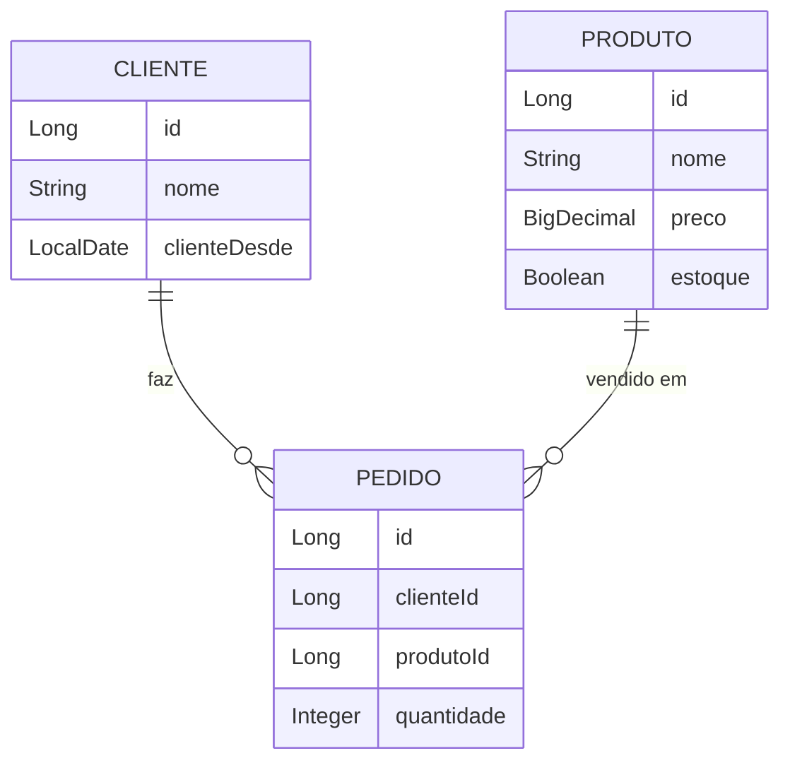

# Baozi Store

API REST para gerenciamento de clientes, produtos e pedidos. O projeto foi desenvolvido com Java e Spring Boot e usa Spring Data JPA para persistência em um banco H2 em memória.

## Tecnologias

- Java 21
- Spring Boot 3.5.7
- Spring Web
- Spring Data JPA e Hibernate
- H2 Database
- Maven Wrapper

## Requisitos

- JDK 21
- IntelliJ IDEA (opcional)
- Acesso à internet na primeira execução para baixar o Maven e as dependências

## Como executar

Abra o projeto no IntelliJ IDEA como projeto Maven selecionando o `pom.xml`. Aguarde a sincronização das dependências e execute a classe `com.aula.baozi.store.Application`.

Para executar pelo terminal, na pasta raiz do projeto:

```powershell
.\mvnw.cmd spring-boot:run
```

Para depurar pelo IntelliJ, selecione a configuração **Baozi Store (Debug)** e clique em **Debug**. A aplicação inicia em `http://localhost:8080`.

## Endpoints

| Método | Caminho | Descrição |
| --- | --- | --- |
| `POST` | `/clientes` | Cadastra um cliente |
| `GET` | `/clientes` | Lista os clientes |
| `GET` | `/clientes/{id}` | Consulta um cliente pelo ID |
| `DELETE` | `/clientes/{id}` | Exclui um cliente |
| `POST` | `/produtos` | Cadastra um produto |
| `GET` | `/produtos` | Lista os produtos |
| `GET` | `/produtos/{id}` | Consulta um produto pelo ID |
| `DELETE` | `/produtos/{id}` | Exclui um produto |
| `POST` | `/pedidos` | Cadastra um pedido |
| `GET` | `/pedidos` | Lista os pedidos |
| `GET` | `/pedidos/{id}` | Consulta um pedido pelo ID |
| `DELETE` | `/pedidos/{id}` | Exclui um pedido |

As operações de cadastro recebem JSON no corpo da requisição. Exemplo para cadastrar um pedido:

```json
{
  "clienteId": 1,
  "produtoId": 1,
  "quantidade": 2
}
```

## Banco de dados H2

O banco é mantido em memória e os dados são apagados quando a aplicação é encerrada. Durante a execução, o console H2 fica disponível em `http://localhost:8080/h2-console`.

- JDBC URL: `jdbc:h2:mem:baozidb`
- Usuário: `sa`
- Senha: em branco

## Organização do código

```text
src/main/java/com/aula/baozi/store/
├── Application.java
├── controller/   # Endpoints REST
├── model/        # Entidades Cliente, Produto e Pedido
└── repository/   # Repositórios Spring Data JPA
```

## Modelo de domínio

O sistema possui as entidades `Cliente`, `Produto` e `Pedido`. Cada pedido armazena `clienteId` e `produtoId` como identificadores do cliente e do produto. No código atual, esses campos são valores `Long`, sem associação JPA direta entre as entidades.

## UML


